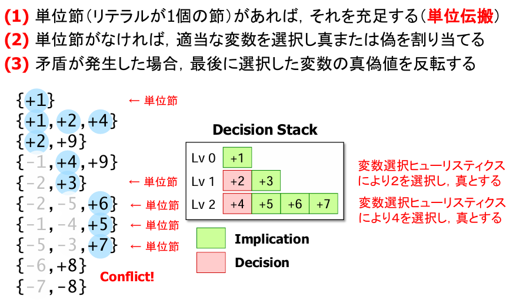
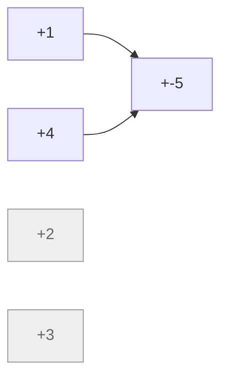

## 目標
SATを理解する。基本的に計算時間がかかることがいろいろな問題の認識で、その問題を解決するために何がこれまでされているかを理解する。

## SATとは
命題論理式の充足可能性を判定する問題。これまで最初にNP完全性と証明された問題。NP完全とは、多項式時間で解けないことが証明された問題。

SAT問題は連語標準形（CNF）で与えられるのが基本で、以下のように表記する。

$$
\begin{gathered}
\underbrace{(a \lor b \lor c)}_{\text{節}} \land (a \lor \lnot c) \land (\lnot b \lor c) \\
\Updownarrow \\
\{\{a,\ b,\ c\},\ \{a,\ \lnot c\},\ \{\lnot b,\ c\}\}
\end{gathered}
$$

上記がtrueになるような $a,b,c$ の系列を見つけることが目標。 and でつないでいるカッコの中すべてが trueになればよいという考え方が基本。カッコを節と呼び、 $a$とかの2値変数をリテラルと呼ぶ。

## 解法1：DPLL[Davis+ 62]
以下の手順が基本。逐次的に全ての節を Tにしていくイメージ。
- 単位節（リテラルが一つの節）があればそれを充足する（単位伝搬）
- 単位節がなければ適当な変数を選択し、真または偽を割り当てる
- 矛盾が発生した場合、最後に選択した変数の真偽値を反転する

上記の画像の例だと数字を変数、正負を T ,F としている。全ての節が T になるような1,2,...,8 系列を求めたい。それぞれの節の中は or で結ばれているので一つでも T になればよい。
手順としては
- Lv 0 で単位節の 1 を T に決定。
- Lv 1 で取りあえず 2　を T にする。 上から5つめの節が単位節になるため、3は Tになる。
- Lv 2 で　4 を Tにしてみる。また単位節がうまれ、5,6,7が　T になる。ただ 8について conflictが起きることがわかる。

4を Tにしたときに問題が起きたので Fにして、次に 6 を Tにしてみる

 

全ての節が Tになり、SAT（充足可能）であるとわかった。

 

現状（2011年時点）でこれくらい差があるらしい。横軸は SAT Competition / SAT Race　というもの。

## 解法2 ：CDCL[Silva 99, Bayardo 97]
ブレイクスルーといわれた解法らしい。DPLLではさかのぼって

{1}
{-1, -4, +5}
{-1, -4, -5}
{-1, +4, +6}
{-1, +4, -6}
{+2, -3, +7}
{-2, +3, -7}

の問題を考える。DPLLの解法でまずSATを求めてみる。
- Lv 0で +1
- Lv 1で +2
- Lv 2で +3
- Lv 3で +4 ,5について couflict
- Lv 3で -4 に修正して,6について couflict
- Lv 2にさかのぼって -3 に修正、-7の伝搬
- Lv 3で+4 ,5について conflict
- Lv 3で-4に修正 ,6について conflict
- Lv 1にさかもどって -2
- Lv 2で +3 ,Lv 3でまた+-4で5,6で　conflict,-3も同様
戻るところがなくなり UNSETを示す

次にCDCLでSATを求める。
- Lv 0で +1
- Lv 1で +2
- Lv 2で +3
- Lv 3で +4 ,5について couflict　

  関係ある部分だけを切り取ったら上記のようになる。2,3が関係ないことがわかり、1,4を両方 Tにしたら問題が起きると分かる。つまり {-1,-4}の節を加える。次の手順としては原因が 1か4にあると分かり、1は単位節なので -4を次は試す。-4でも 6でconfloctが起きることがわかっているので、UNSATと証明完了。

  CDCLはconflictが起きる原因を節として追加し、同じ原因での conflictが起きないようにできる。

## 解法 3 ：VSIDS　  [Moskewicz+ 01] 
充足する変数の決め方を改善。conflictが起きる部分を優先的に調べられる。方法は以下
- 各変数ごとに優先度を表すカウンタを用意し、0で初期化
- 学習説（CDCLでのclnflictが起きたことにより追加された節）が追加されるたび、その節中の変数のカウンタを増加
- 最も高い優先度を持つ未割当変数を選択していく。それを偽として割り当てる。
  - ここで偽にしているのは問題設定の関係で偽のほうが効果が多い場合が多いらしい
  - 最近のソルバーでは前回その辺素に割り当てていた値をもう一度扱う方法が主流
- 定期的にすべてのカウンタの値を定数で割り減少させる
  - 最近追加された学習節の変数を優先して選択するため

この手法によりconflictと関係が小さい変数を選択する回数が減り、conflictと関係がある変数を優先的に選択できるようになった。

## 監視リテラル [Moskewicz+ 01]
SATソルバーの実行時間は70~90%は単位伝搬の処理。効率の良い単位節検出アルゴリズムがほしい。

## 状態遷移システム
$Q$ を状態の集合とする。初期状態を $Q_0\subseteq Q$ とする。  $T$を状態遷移の関係とする。 $T\subset Q\times Q$
状態 $Q$は二値変数 を $m$個つかって $x = [x_1,...,x_m]$と表せる。
状態遷移を Tとするとしたら　状態遷移後の状態を、$y = [y_1,...,y_m]$で表す。
### Bounded Model Checking
初期の状態について $x_0$として、それが初期条件を満たしているかは $F_{Q_0}(x_0)$と表記される。この関数が0,1を返す。
状態の遷移については $F_T(x_0,x_1)$で表される。 状態の遷移 $T$のルールを守って状態が遷移されるイメージ。これも満たされているか満たされていないかの0,1で表される。
最終的に満たされてほしい状態を $Q_P$とする。

 そうすると $n$期後に満たされてほしい状態 $Q_P$に行きつくような系列は以下を満たす
 $$
 F_{Q_0}(\vec{x}_0) \land F_T(\vec{x}_0, \vec{x}_1) \land \cdots \land F_T(\vec{x}_{n-1}, \vec{x}_n) \land F_{Q_P}(\vec{x}_n)
 $$

状態$x$が 条件$P$を満たしているかはさっき節で表してSATかどうかを確かめる方法を確認した。
状態遷移に関しては満たしているかどうかを節で表すことできる？
状態について$\{x_1,x_2\}$から $\{y_1,y_2\}$の遷移を考えたとき、状態遷移のルールとして $x_1$が Tなら その次の状態は$y_2$が Tとする。
つまり

| 今の状態 $(x_1, x_2)$ | 遷移できる次の状態 $(y_1, y_2)$ |
|---|---|
| (F, F) | 4 つ全部 |
| (F, T) | 4 つ全部 |
| (T, F) | (F, T) と (T, T) だけ |
| (T, T) | (F, T) と (T, T) だけ |

このように二つの状態が特定の条件を満たすとき $F_T(x,y)$はTとできる。
これを節であらわすと、
$\{-x_1, +x_2, +y_2\}$,
$\{-x_1, -x_2, +y_2\}$

状態遷移について節で表せえることを確認した。
これらから状態遷移系をすべて節とandでつなげることができることを確認した。

## 参考
https://atrg.jp/ja/index.php?file=20141015-atos10.pdf&pcmd=open&plugin=attach&refer=ATOS10&utm_source=chatgpt.com
https://cvc4.cs.stanford.edu/logic/slides/lec3.pdf
