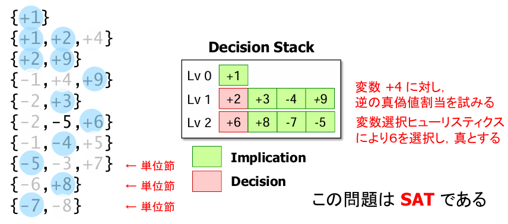
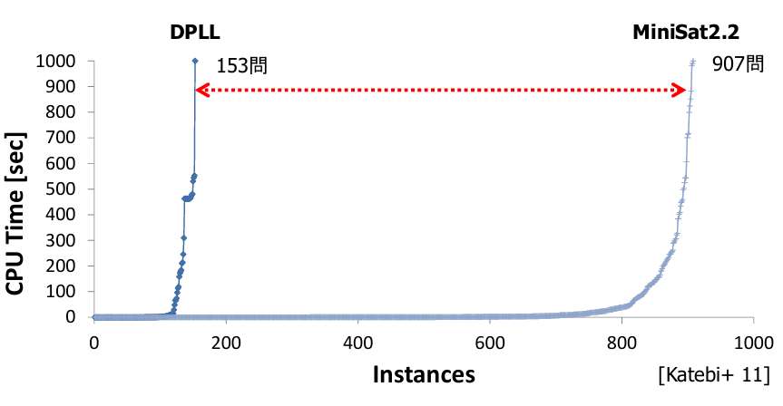

## 目標
SATを理解する。基本的に計算時間がかかることがいろいろな問題の認識で、その問題を解決するために何がこれまでされているかを理解する。

## SATとは
命題論理式の充足可能性を判定する問題。これまで最初にNP完全性と証明された問題。NP完全とは、多項式時間で解けないことが証明された問題。

SAT問題は連語標準形（CNF）で与えられるのが基本で、以下のように表記する。

$$
\begin{gathered}
\underbrace{(a \lor b \lor c)}_{\text{節}} \land (a \lor \lnot c) \land (\lnot b \lor c) \\
\Updownarrow \\
\{\{a,\ b,\ c\},\ \{a,\ \lnot c\},\ \{\lnot b,\ c\}\}
\end{gathered}
$$

上記がtrueになるような $a,b,c$ の系列を見つけることが目標。 and でつないでいるカッコの中すべてが trueになればよいという考え方が基本。カッコを節と呼び、 $a$とかの2値変数をリテラルと呼ぶ。

## 解法1：DPLL[Davis+ 62]
以下の手順が基本。
- 単位節（リテラルが一つの節）があればそれを充足する（単位伝搬）
-　単位節がなければ適当な変数を選択し、真または偽を割り当てる
- 矛盾が発生した場合、最後に選択した変数の真偽値を反転する

上記の画像の例だと数字を変数、正負を T ,F としている。全ての節が T になるような1,2,...,8 系列を求めたい。それぞれの節の中は or で結ばれているので一つでも T になればよい。
手順としては
- Lv 0 で単位節の 1 を T に決定。
- Lv 1 で取りあえず 2　を T にする。 上から5つめの節が単位節になるため、3は Tになる。
- Lv 2 で　4 を Tにしてみる。また単位節がうまれ、5,6,7が　T になる。ただ 8について conflictが起きることがわかる。

4を Tにしたのが原因だったので取り消し、 6 を Tにしてみる

